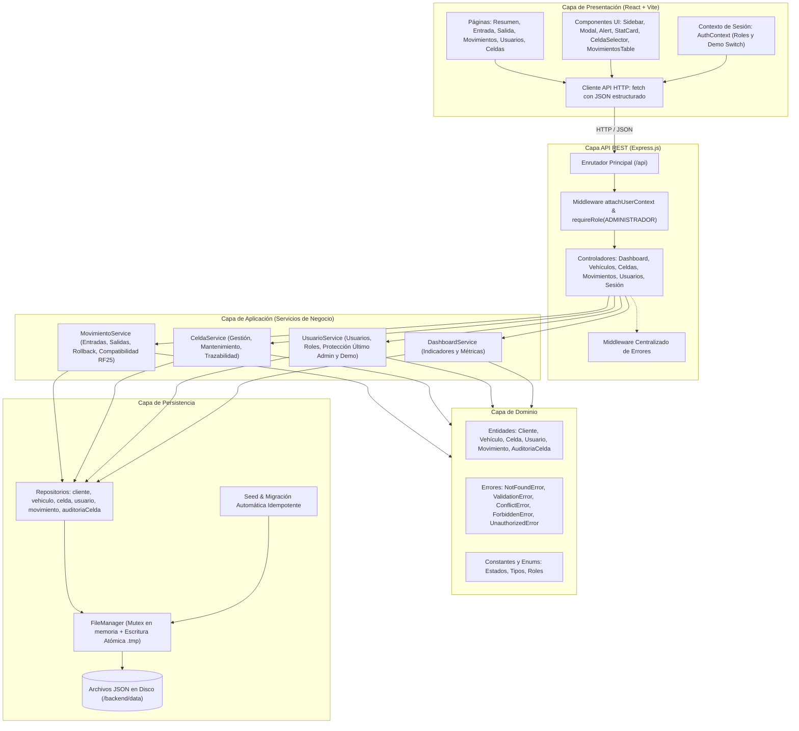
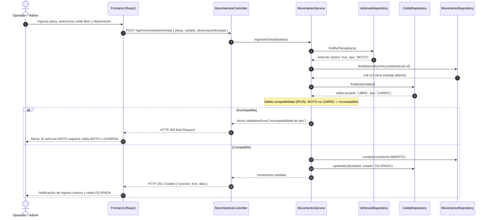
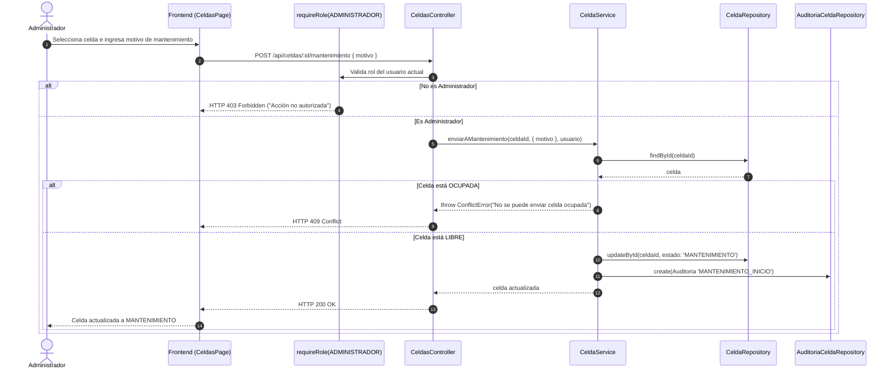

# 🏗️ Arquitectura del Sistema — Autos Colombia

**Versión:** 2.0 (Iteración 1 e Iteración 2)  
**Fecha:** Noviembre 2026

---

## 1. Arquitectura Lógica en Capas

El sistema implementa una arquitectura en capas desacopladas que garantiza la separación de responsabilidades:

---

## 2. Diagrama de Secuencia: Registrar Entrada con Validación de Compatibilidad (RF25)

---

## 3. Diagrama de Secuencia: Enviar Celda a Mantenimiento (Iteración 2)

---

## 4. Estrategia de Migración Futura a Base de Datos Relacional (MySQL)

Gracias al patrón repositorio implementado:
1. Las entidades de negocio y la lógica de validación se encuentran en `application/` y `domain/`.
2. Para cambiar de archivos JSON a MySQL, solo se reemplazarán las implementaciones internas de los repositorios en `persistence/repositories/*.js` por consultas SQL mediante `mysql2` o un ORM (Prisma / Sequelize / Knex).
3. **Ni una sola línea de los componentes React ni de los controladores Express tendrá que modificarse.**
