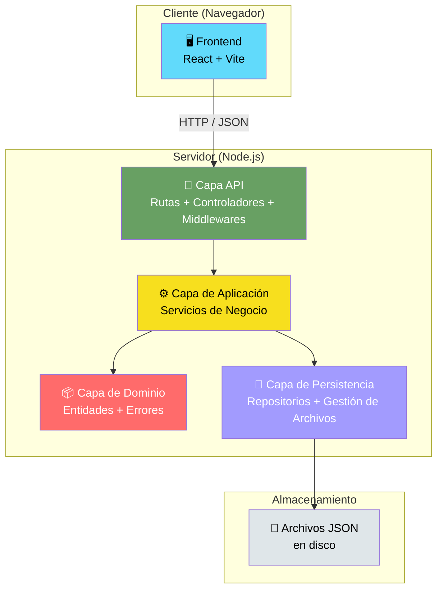
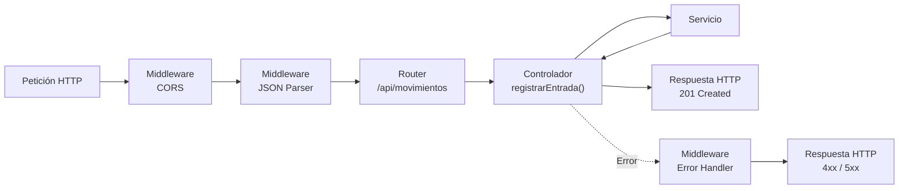
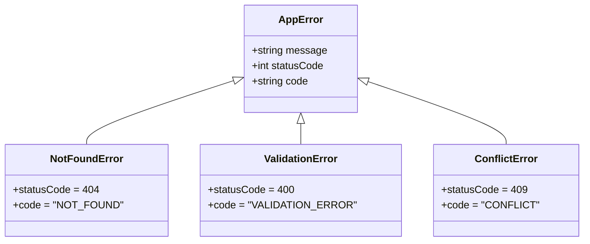
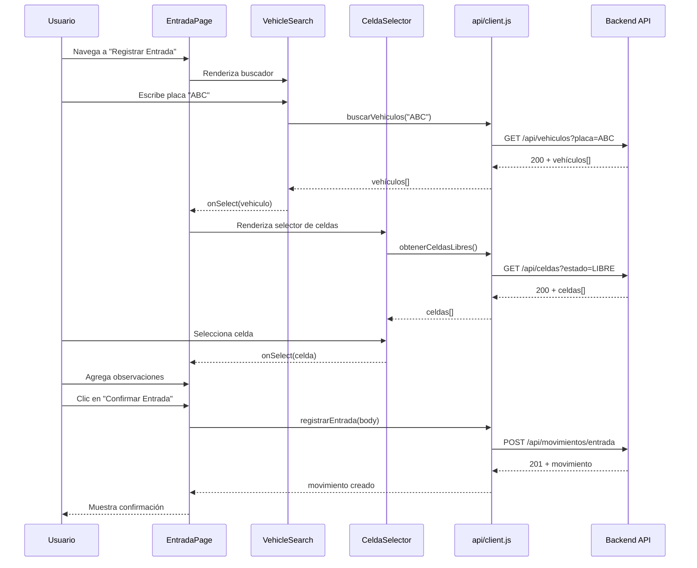
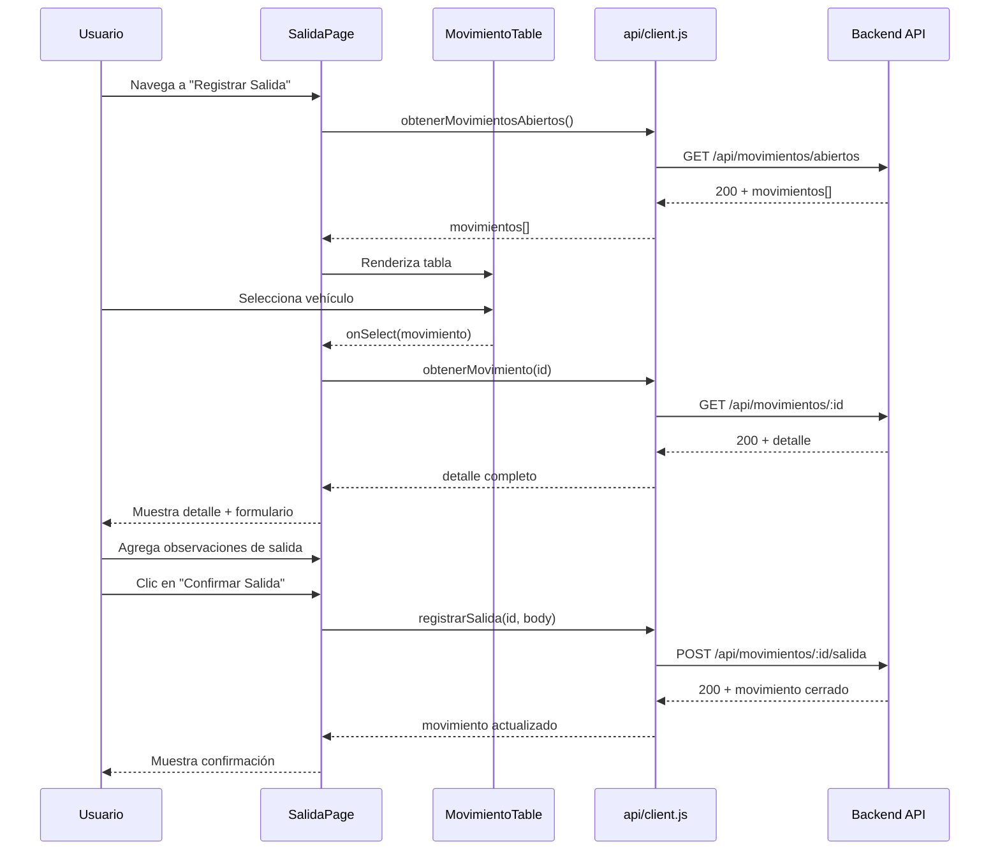
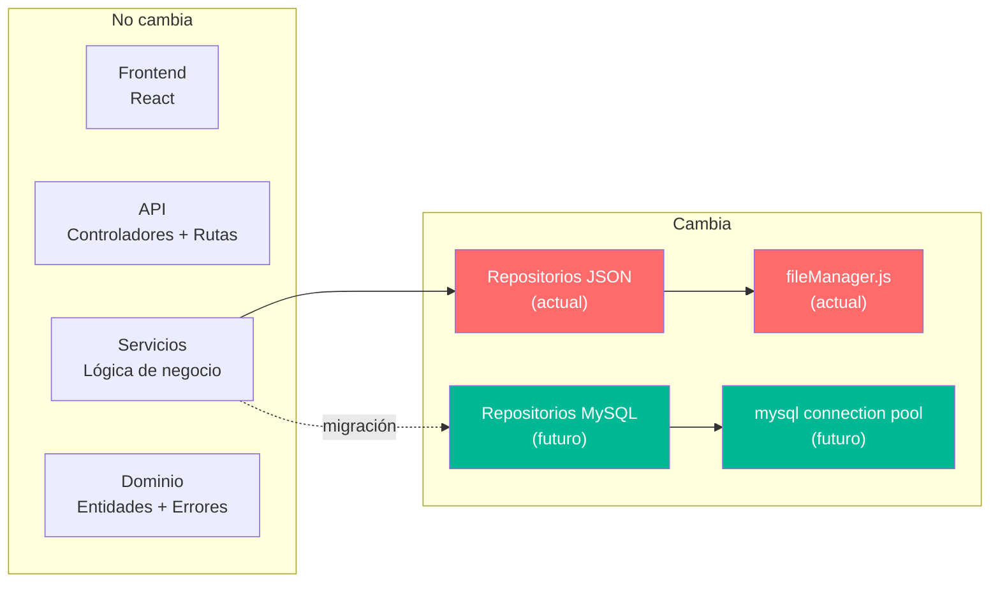

# 🏗️ Arquitectura del Sistema — Autos Colombia

**Versión:** 1.0  
**Iteración:** 1  
**Fecha:** Octubre 2026

---

## 1. Visión General

Autos Colombia sigue una **arquitectura por capas** (layered architecture) tanto en el backend como en el frontend. Este enfoque separa las responsabilidades en niveles bien definidos, facilitando la mantenibilidad, testabilidad y la futura migración de la capa de persistencia.



### Principio fundamental

> **La capa de persistencia es la única que conoce el mecanismo de almacenamiento.** Los servicios, controladores y componentes de React trabajan con interfaces abstractas, permitiendo sustituir archivos JSON por MySQL (u otra base de datos) sin modificar la lógica de negocio ni la interfaz de usuario.

---

## 2. Organización de Paquetes

### 2.1 Backend — 6 capas

```
backend/src/
├── index.js                    # Punto de entrada
├── app.js                      # Configuración de Express
├── config/                     # ① Configuración
│   └── constants.js            # Puerto, rutas, valores por defecto
├── api/                        # ② Capa API (interfaz HTTP)
│   ├── routes/                 # Definición de rutas
│   │   ├── dashboard.routes.js
│   │   ├── vehiculo.routes.js
│   │   ├── celda.routes.js
│   │   └── movimiento.routes.js
│   ├── controllers/            # Controladores (traducir HTTP ↔ servicio)
│   │   ├── dashboard.controller.js
│   │   ├── vehiculo.controller.js
│   │   ├── celda.controller.js
│   │   └── movimiento.controller.js
│   └── middlewares/            # Middlewares transversales
│       ├── errorHandler.js     # Manejo centralizado de errores
│       └── validateRequest.js  # Validación de parámetros
├── application/                # ③ Capa de Aplicación (lógica de negocio)
│   ├── dashboard.service.js
│   ├── vehiculo.service.js
│   ├── celda.service.js
│   └── movimiento.service.js
├── domain/                     # ④ Capa de Dominio (entidades y errores)
│   ├── entities/
│   │   ├── Cliente.js
│   │   ├── Vehiculo.js
│   │   ├── Celda.js
│   │   ├── Movimiento.js
│   │   └── Usuario.js
│   └── errors/
│       ├── AppError.js         # Error base de la aplicación
│       ├── NotFoundError.js
│       ├── ValidationError.js
│       └── ConflictError.js
└── persistence/                # ⑤ Capa de Persistencia
    ├── fileManager.js          # Lectura/escritura de archivos JSON
    ├── seedData.js             # Generación de datos de demostración
    └── repositories/           # ⑥ Repositorios (patrón Repository)
        ├── cliente.repository.js
        ├── vehiculo.repository.js
        ├── celda.repository.js
        ├── movimiento.repository.js
        └── usuario.repository.js
```

### 2.2 Frontend — Organización por tipo

```
frontend/src/
├── main.jsx                    # Punto de entrada React
├── App.jsx                     # Router y layout principal
├── App.css                     # Estilos globales
├── api/                        # Cliente HTTP
│   └── client.js               # Funciones para cada endpoint
├── hooks/                      # Hooks personalizados
│   ├── useDashboard.js
│   ├── useVehiculos.js
│   ├── useCeldas.js
│   └── useMovimientos.js
├── components/                 # Componentes reutilizables
│   ├── Layout.jsx              # Layout con navegación
│   ├── Navbar.jsx              # Barra de navegación
│   ├── StatCard.jsx            # Tarjeta de indicador
│   ├── VehicleSearch.jsx       # Buscador de vehículos
│   ├── CeldaSelector.jsx      # Selector de celda
│   ├── MovimientoTable.jsx     # Tabla de movimientos
│   └── ConfirmDialog.jsx       # Diálogo de confirmación
└── pages/                      # Páginas (vistas)
    ├── DashboardPage.jsx       # Resumen / Dashboard
    ├── EntradaPage.jsx         # Registrar entrada
    ├── SalidaPage.jsx          # Registrar salida
    └── MovimientosPage.jsx     # Historial de movimientos
```

---

## 3. Descripción de Capas

### 3.1 Capa de Configuración (`config/`)

| Responsabilidad | Detalle |
|----------------|---------|
| Puerto del servidor | `PORT = 3001` |
| Rutas de datos | `DATA_DIR = './data'` |
| Valores por defecto | Tamaños de página, timeouts, etc. |

### 3.2 Capa API (`api/`)

La capa API actúa como **interfaz entre el mundo HTTP y la lógica de negocio**. Se compone de tres elementos:

| Componente | Responsabilidad |
|-----------|----------------|
| **Rutas** | Definen los endpoints HTTP (método + ruta) y los asocian a controladores. |
| **Controladores** | Extraen parámetros de la petición, invocan al servicio correspondiente y formatean la respuesta HTTP. No contienen lógica de negocio. |
| **Middlewares** | Procesan la petición de forma transversal: manejo de errores, validación de parámetros, CORS. |



### 3.3 Capa de Aplicación (`application/`)

Contiene la **lógica de negocio** del sistema. Los servicios:

- Orquestan operaciones entre múltiples repositorios
- Aplican reglas de negocio y validaciones
- Lanzan errores de dominio cuando las condiciones no se cumplen
- Son independientes del protocolo HTTP

| Servicio | Responsabilidad |
|----------|----------------|
| `movimiento.service.js` | Registrar entradas, registrar salidas, consultar movimientos abiertos, historial con filtros |
| `vehiculo.service.js` | Buscar vehículos por placa, validar estado activo |
| `celda.service.js` | Consultar celdas por estado, verificar compatibilidad de tipo |
| `dashboard.service.js` | Calcular indicadores de ocupación |

### 3.4 Capa de Dominio (`domain/`)

Define las **entidades del negocio** y los **errores personalizados**.

**Entidades:** Representan los objetos de negocio con sus propiedades y validaciones internas. No tienen dependencias externas.

**Errores:** Jerarquía de errores de dominio que el middleware de error traduce a códigos HTTP apropiados.



### 3.5 Capa de Persistencia (`persistence/`)

Implementa el **patrón Repository** para abstraer el acceso a datos.

| Componente | Responsabilidad |
|-----------|----------------|
| `fileManager.js` | Lectura y escritura atómica de archivos JSON. Manejo de concurrencia básica. |
| `seedData.js` | Generación de datos de demostración al primer inicio. |
| Repositorios | Un repositorio por entidad. Exponen métodos CRUD que internamente usan `fileManager`. |

**Interfaz abstracta de los repositorios:**

```
obtenerTodos()          → Entity[]
obtenerPorId(id)        → Entity | null
buscar(filtro)          → Entity[]
crear(entity)           → Entity
actualizar(id, datos)   → Entity
eliminar(id)            → boolean
```

### 3.6 Capa Frontend

| Componente | Responsabilidad |
|-----------|----------------|
| `api/client.js` | Cliente HTTP que encapsula las llamadas `fetch` a la API REST. |
| `hooks/` | Custom hooks que gestionan estado, carga, errores y llamadas al API. |
| `components/` | Componentes React reutilizables (presentacionales + funcionales). |
| `pages/` | Páginas que componen las vistas principales de la aplicación. |

---

## 4. Interacción entre Componentes

### 4.1 Flujo de Registro de Entrada



### 4.2 Flujo de Registro de Salida



---

## 5. Stack Tecnológico — Justificación

### 5.1 Frontend

| Tecnología | Justificación |
|-----------|---------------|
| **React 18** | Librería de UI más adoptada. Ecosistema maduro, comunidad activa, amplia documentación. Componentes reactivos ideales para actualizar indicadores en tiempo real. |
| **Vite 5** | Build tool de nueva generación. Inicio instantáneo en desarrollo (ESM nativo), HMR ultrarrápido, configuración mínima. Superior a Create React App en rendimiento. |
| **React Router 6** | Enrutamiento declarativo estándar para SPAs en React. Soporta layouts anidados y rutas dinámicas. |
| **Lucide Icons** | Set de iconos consistente, ligero y con soporte nativo para React. Mejora la legibilidad de la interfaz. |
| **CSS personalizado** | Sin frameworks CSS para mantener el bundle pequeño y el control total sobre los estilos. Adecuado para la escala del proyecto. |

### 5.2 Backend

| Tecnología | Justificación |
|-----------|---------------|
| **Node.js** | Runtime JavaScript en servidor. Permite usar el mismo lenguaje en frontend y backend, simplificando el desarrollo. |
| **Express 4** | Framework HTTP minimalista y flexible. Estándar de facto para APIs REST en Node.js. Ecosystem extenso de middlewares. |
| **Archivos JSON** | Almacenamiento simple para la iteración 1. No requiere instalación de base de datos. Facilita el desarrollo y las pruebas. Diseñado para ser reemplazado por MySQL. |

### 5.3 Comunicación

| Aspecto | Decisión |
|---------|----------|
| **Protocolo** | HTTP/1.1 |
| **Formato** | JSON |
| **Patrón** | REST (recursos + verbos HTTP) |
| **CORS** | Habilitado para `localhost:5173` (frontend Vite) |

---

## 6. Ruta de Migración a MySQL

La arquitectura está diseñada para soportar la migración de archivos JSON a MySQL **sin modificar** las capas de Aplicación, API ni Frontend.

### 6.1 Qué cambia



### 6.2 Pasos de migración

| Paso | Descripción |
|------|-------------|
| 1 | Instalar driver MySQL (`mysql2`) y configurar pool de conexiones. |
| 2 | Crear las tablas en MySQL usando el DDL definido en `modelo-datos.md`. |
| 3 | Migrar los datos de los archivos JSON a las tablas MySQL con un script. |
| 4 | Crear nuevas implementaciones de los repositorios que usen SQL en lugar de `fileManager`. |
| 5 | Actualizar las importaciones en los servicios para usar los nuevos repositorios. |
| 6 | Eliminar `fileManager.js`, `seedData.js` y los archivos JSON. |
| 7 | Probar que toda la API funciona igual. |

### 6.3 Requisitos para la migración

- Los repositorios deben mantener **la misma interfaz** (mismos métodos, mismos parámetros, mismos retornos).
- Los servicios no deben importar ni conocer `fileManager.js`.
- Las entidades de dominio no deben tener dependencias de persistencia.

---

## 7. Decisiones de Diseño

| Decisión | Alternativa considerada | Justificación |
|----------|------------------------|---------------|
| Arquitectura por capas | MVC clásico | Las capas permiten aislar la persistencia para facilitar la migración a MySQL. MVC no define claramente dónde vive la lógica de negocio. |
| Archivos JSON en disco | SQLite | JSON es más simple de inspeccionar y editar. SQLite requiere driver nativo. Ambos son temporales antes de MySQL. |
| CSS sin framework | Tailwind / Bootstrap | Menor complejidad de setup. Control total sobre estilos. Apropiado para la escala del proyecto. |
| REST con Express | GraphQL / tRPC | REST es más simple, ampliamente conocido y suficiente para los endpoints actuales. |
| Datos de demo auto-generados | Migración manual | Facilita el onboarding y las pruebas sin pasos adicionales. |
| Operador hardcoded | Auth básica | Simplifica la iteración 1. La autenticación se implementará con JWT en la iteración 2. |
