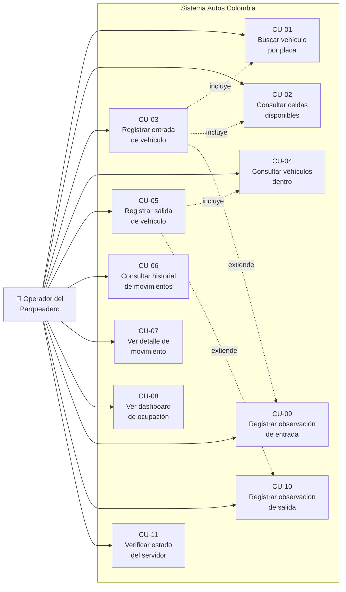
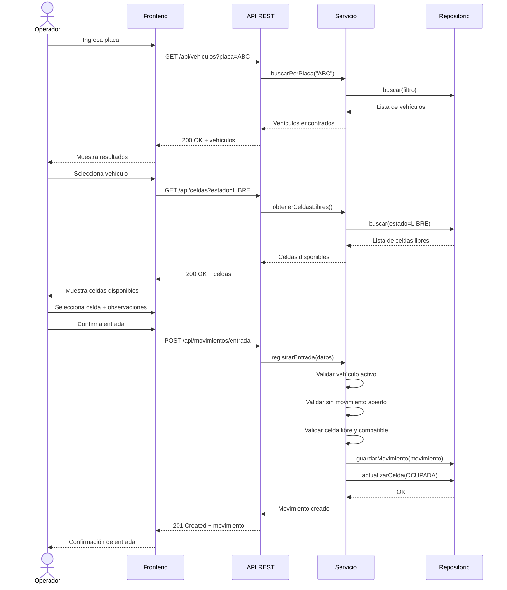
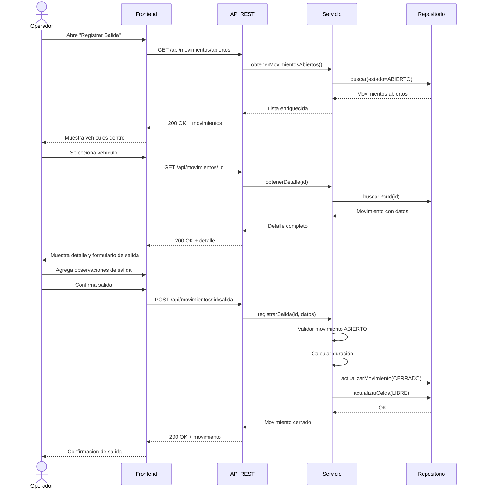

# 🎯 Casos de Uso — Autos Colombia

**Versión:** 1.0  
**Iteración:** 1  
**Fecha:** Octubre 2026

---

## Diagrama General de Casos de Uso

---

## CU-01: Buscar vehículo por placa

| Campo | Detalle |
|-------|---------|
| **ID** | CU-01 |
| **Actor principal** | Operador del parqueadero |
| **Descripción** | El operador busca un vehículo registrado en el sistema ingresando parte de su placa. |
| **Precondiciones** | El sistema está en funcionamiento. Existen vehículos registrados en la base de datos. |

### Flujo principal

1. El operador ingresa al menos 2 caracteres de la placa en el campo de búsqueda.
2. El sistema busca vehículos cuya placa contenga el texto ingresado (sin distinguir mayúsculas/minúsculas).
3. El sistema retorna la lista de vehículos que coinciden, incluyendo: placa, tipo, marca, modelo, color, estado y datos del propietario (nombre, documento).
4. El operador selecciona el vehículo deseado.

### Flujos alternativos

| Código | Condición | Acción |
|--------|-----------|--------|
| FA-01a | El texto de búsqueda tiene menos de 2 caracteres | El sistema indica que se requieren al menos 2 caracteres. |
| FA-01b | No se encuentran vehículos que coincidan | El sistema muestra un mensaje indicando que no hay resultados. |
| FA-01c | El vehículo encontrado no está activo | El sistema lo muestra pero impide su selección para registro de entrada. |

### Postcondiciones

- El operador ha identificado el vehículo deseado de la lista de resultados.

---

## CU-02: Consultar celdas disponibles

| Campo | Detalle |
|-------|---------|
| **ID** | CU-02 |
| **Actor principal** | Operador del parqueadero |
| **Descripción** | El operador consulta las celdas que están disponibles (estado LIBRE) para asignar a un vehículo. |
| **Precondiciones** | El sistema está en funcionamiento. Existen celdas registradas en el sistema. |

### Flujo principal

1. El operador solicita ver las celdas disponibles.
2. El sistema filtra las celdas con estado `LIBRE`.
3. El sistema retorna la lista de celdas libres con: código, tipo (CARRO, MOTO, CAMIONETA), ubicación y estado.
4. El operador visualiza las opciones disponibles.

### Flujos alternativos

| Código | Condición | Acción |
|--------|-----------|--------|
| FA-02a | No hay celdas libres | El sistema muestra un mensaje indicando que el parqueadero está lleno. |
| FA-02b | No hay celdas libres del tipo requerido | El sistema muestra solo las celdas compatibles; si no hay ninguna, informa al operador. |

### Postcondiciones

- El operador conoce las celdas disponibles y puede proceder a asignar una.

---

## CU-03: Registrar entrada de vehículo

| Campo | Detalle |
|-------|---------|
| **ID** | CU-03 |
| **Actor principal** | Operador del parqueadero |
| **Descripción** | El operador registra la entrada de un vehículo al parqueadero, asignándole una celda disponible. |
| **Precondiciones** | El vehículo está registrado y activo. El vehículo no tiene un movimiento abierto. Existen celdas libres compatibles. |

### Flujo principal

1. El operador busca el vehículo por placa (**incluye CU-01**).
2. El operador selecciona el vehículo de los resultados.
3. El sistema verifica que el vehículo está activo y no tiene un movimiento abierto.
4. El sistema muestra las celdas disponibles compatibles con el tipo de vehículo (**incluye CU-02**).
5. El operador selecciona una celda.
6. *(Opcional)* El operador registra observaciones de entrada (**extiende CU-09**).
7. El operador confirma el registro de entrada.
8. El sistema crea un movimiento con estado `ABIERTO`, fecha/hora de entrada actual y la celda asignada.
9. El sistema cambia el estado de la celda de `LIBRE` a `OCUPADA`.
10. El sistema muestra un mensaje de confirmación con el resumen: placa, celda asignada, hora de entrada.

### Flujos alternativos

| Código | Condición | Acción |
|--------|-----------|--------|
| FA-03a | El vehículo no está activo | El sistema muestra error: "El vehículo no se encuentra activo". |
| FA-03b | El vehículo ya tiene un movimiento abierto | El sistema muestra error: "El vehículo ya se encuentra dentro del parqueadero" con los datos del movimiento actual. |
| FA-03c | La celda seleccionada ya no está disponible (concurrencia) | El sistema muestra error: "La celda ya no está disponible. Seleccione otra." |
| FA-03d | El tipo de celda no es compatible con el vehículo | El sistema no muestra celdas incompatibles en la lista. |
| FA-03e | El operador cancela la operación | El sistema no crea ningún movimiento ni modifica estados. Retorna al estado anterior. |

### Postcondiciones

- Existe un nuevo movimiento con estado `ABIERTO`.
- La celda asignada tiene estado `OCUPADA`.

### Diagrama de secuencia

---

## CU-04: Consultar vehículos dentro del parqueadero

| Campo | Detalle |
|-------|---------|
| **ID** | CU-04 |
| **Actor principal** | Operador del parqueadero |
| **Descripción** | El operador consulta la lista de todos los vehículos que se encuentran actualmente dentro del parqueadero. |
| **Precondiciones** | El sistema está en funcionamiento. |

### Flujo principal

1. El operador accede a la vista de vehículos dentro (o al dashboard).
2. El sistema consulta todos los movimientos con estado `ABIERTO`.
3. El sistema muestra una tabla con: placa, tipo de vehículo, marca y modelo, celda asignada, hora de entrada y tiempo transcurrido.
4. El operador visualiza la información.

### Flujos alternativos

| Código | Condición | Acción |
|--------|-----------|--------|
| FA-04a | No hay vehículos dentro | El sistema muestra un mensaje: "No hay vehículos dentro del parqueadero actualmente." |

### Postcondiciones

- El operador conoce la ocupación actual del parqueadero.

---

## CU-05: Registrar salida de vehículo

| Campo | Detalle |
|-------|---------|
| **ID** | CU-05 |
| **Actor principal** | Operador del parqueadero |
| **Descripción** | El operador registra la salida de un vehículo que se encuentra dentro del parqueadero. |
| **Precondiciones** | El vehículo tiene un movimiento abierto (está dentro del parqueadero). |

### Flujo principal

1. El operador consulta los vehículos dentro del parqueadero (**incluye CU-04**).
2. El operador selecciona el vehículo cuya salida desea registrar.
3. El sistema muestra el detalle del movimiento: datos del vehículo, celda asignada, hora de entrada, tiempo transcurrido y observaciones de entrada.
4. *(Opcional)* El operador registra observaciones de salida (**extiende CU-10**).
5. El operador confirma la salida.
6. El sistema registra la hora de salida y calcula la duración total de la estancia.
7. El sistema cambia el estado del movimiento de `ABIERTO` a `CERRADO`.
8. El sistema cambia el estado de la celda de `OCUPADA` a `LIBRE`.
9. El sistema muestra un mensaje de confirmación con el resumen: placa, celda, hora de entrada, hora de salida, duración.

### Flujos alternativos

| Código | Condición | Acción |
|--------|-----------|--------|
| FA-05a | El movimiento ya fue cerrado (concurrencia) | El sistema muestra error: "Este movimiento ya ha sido cerrado." |
| FA-05b | El operador cancela la operación | El sistema no modifica el movimiento ni la celda. Retorna al estado anterior. |

### Postcondiciones

- El movimiento tiene estado `CERRADO` con hora de salida y duración.
- La celda tiene estado `LIBRE`.

### Diagrama de secuencia

---

## CU-06: Consultar historial de movimientos

| Campo | Detalle |
|-------|---------|
| **ID** | CU-06 |
| **Actor principal** | Operador del parqueadero |
| **Descripción** | El operador consulta el historial completo de movimientos con opciones de filtrado. |
| **Precondiciones** | El sistema está en funcionamiento. |

### Flujo principal

1. El operador accede a la pantalla de historial de movimientos.
2. El sistema carga y muestra todos los movimientos ordenados por fecha de entrada descendente.
3. *(Opcional)* El operador aplica filtros:
   - **Placa:** Ingresa texto para filtrar por placa (búsqueda parcial).
   - **Fecha desde:** Selecciona una fecha de inicio.
   - **Fecha hasta:** Selecciona una fecha de fin.
   - **Estado:** Selecciona ABIERTO, CERRADO o Todos.
4. El sistema filtra los resultados según los criterios aplicados.
5. El operador visualiza la tabla con los resultados.

### Flujos alternativos

| Código | Condición | Acción |
|--------|-----------|--------|
| FA-06a | No hay movimientos que cumplan los filtros | El sistema muestra: "No se encontraron movimientos con los filtros aplicados." |
| FA-06b | El operador limpia los filtros | El sistema muestra todos los movimientos sin filtros. |

### Postcondiciones

- El operador ha consultado el historial con los filtros deseados.

---

## CU-07: Ver detalle de movimiento

| Campo | Detalle |
|-------|---------|
| **ID** | CU-07 |
| **Actor principal** | Operador del parqueadero |
| **Descripción** | El operador consulta el detalle completo de un movimiento específico. |
| **Precondiciones** | El movimiento existe en el sistema. |

### Flujo principal

1. El operador selecciona un movimiento de la lista (historial, dashboard o lista de vehículos dentro).
2. El sistema consulta el detalle del movimiento por su ID.
3. El sistema muestra toda la información: datos del vehículo (placa, tipo, marca, modelo, color), datos del propietario, celda asignada, hora de entrada, hora de salida (si aplica), duración (si aplica), observaciones de entrada, observaciones de salida, estado y operador que registró el movimiento.

### Flujos alternativos

| Código | Condición | Acción |
|--------|-----------|--------|
| FA-07a | El movimiento no existe | El sistema muestra error 404: "Movimiento no encontrado." |

### Postcondiciones

- El operador ha visualizado toda la información del movimiento.

---

## CU-08: Ver dashboard de ocupación

| Campo | Detalle |
|-------|---------|
| **ID** | CU-08 |
| **Actor principal** | Operador del parqueadero |
| **Descripción** | El operador visualiza el dashboard con los indicadores principales del parqueadero. |
| **Precondiciones** | El sistema está en funcionamiento. |

### Flujo principal

1. El operador accede a la pantalla principal (Resumen).
2. El sistema consulta los indicadores actuales del parqueadero.
3. El sistema muestra tarjetas con:
   - Total de celdas
   - Celdas libres
   - Celdas ocupadas
   - Porcentaje de ocupación
   - Vehículos dentro
   - Movimientos del día
4. El sistema muestra accesos rápidos: "Registrar Entrada" y "Registrar Salida".
5. El sistema muestra una tabla resumen con los vehículos actualmente dentro.

### Flujos alternativos

| Código | Condición | Acción |
|--------|-----------|--------|
| FA-08a | Error al cargar los datos | El sistema muestra un mensaje de error con opción de reintentar. |

### Postcondiciones

- El operador tiene una visión general de la ocupación del parqueadero.

---

## CU-09: Registrar observación de entrada

| Campo | Detalle |
|-------|---------|
| **ID** | CU-09 |
| **Actor principal** | Operador del parqueadero |
| **Descripción** | El operador agrega observaciones textuales sobre el estado del vehículo al momento de su entrada. |
| **Precondiciones** | El operador se encuentra en el flujo de registro de entrada (CU-03). |

### Flujo principal

1. Durante el registro de entrada, el operador localiza el campo de observaciones.
2. El operador escribe las observaciones (máximo 500 caracteres).
3. Las observaciones se incluyen en el movimiento al confirmar la entrada.

### Flujos alternativos

| Código | Condición | Acción |
|--------|-----------|--------|
| FA-09a | El operador no ingresa observaciones | El campo se almacena como `null`. No se genera error. |
| FA-09b | El texto excede 500 caracteres | El sistema trunca o impide ingresar más caracteres. |

### Postcondiciones

- Las observaciones de entrada quedan registradas en el movimiento.

---

## CU-10: Registrar observación de salida

| Campo | Detalle |
|-------|---------|
| **ID** | CU-10 |
| **Actor principal** | Operador del parqueadero |
| **Descripción** | El operador agrega observaciones textuales sobre el estado del vehículo al momento de su salida. |
| **Precondiciones** | El operador se encuentra en el flujo de registro de salida (CU-05). |

### Flujo principal

1. Durante el registro de salida, el operador localiza el campo de observaciones.
2. El operador escribe las observaciones (máximo 500 caracteres).
3. Las observaciones se incluyen en el movimiento al confirmar la salida.

### Flujos alternativos

| Código | Condición | Acción |
|--------|-----------|--------|
| FA-10a | El operador no ingresa observaciones | El campo se almacena como `null`. No se genera error. |
| FA-10b | El texto excede 500 caracteres | El sistema trunca o impide ingresar más caracteres. |

### Postcondiciones

- Las observaciones de salida quedan registradas en el movimiento.

---

## CU-11: Verificar estado del servidor

| Campo | Detalle |
|-------|---------|
| **ID** | CU-11 |
| **Actor principal** | Operador del parqueadero / Sistema |
| **Descripción** | Se verifica que el servidor backend esté funcionando correctamente. |
| **Precondiciones** | Ninguna. |

### Flujo principal

1. El cliente (frontend o herramienta de monitoreo) envía una petición al endpoint de salud.
2. El servidor responde con estado `200 OK` y un mensaje indicando que está funcionando.

### Flujos alternativos

| Código | Condición | Acción |
|--------|-----------|--------|
| FA-11a | El servidor no responde | El cliente muestra un error de conexión. |

### Postcondiciones

- Se confirma que el servidor está operativo.

---

## Matriz de Trazabilidad: Casos de Uso ↔ Requisitos

| Caso de Uso | Requisitos Funcionales | Reglas de Negocio |
|-------------|----------------------|-------------------|
| CU-01 | RF-05 | — |
| CU-02 | RF-06 | RN-03 |
| CU-03 | RF-01 | RN-01, RN-02, RN-03, RN-04, RN-05 |
| CU-04 | RF-03 | — |
| CU-05 | RF-02 | RN-06, RN-07 |
| CU-06 | RF-04 | — |
| CU-07 | RF-04 | — |
| CU-08 | RF-07 | — |
| CU-09 | RF-08 | RN-08 |
| CU-10 | RF-08 | RN-08 |
| CU-11 | — | — |
