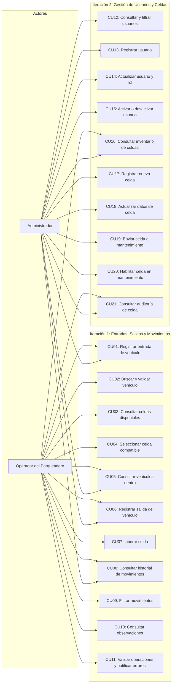

# 🎯 Casos de Uso — Autos Colombia

**Versión:** 2.0 (Iteración 1 e Iteración 2)  
**Fecha:** Noviembre 2026

---

## 1. Diagrama General de Casos de Uso

---

## 2. Casos de Uso de la Iteración 2

### CU12: Consultar y Filtrar Usuarios
- **Actor principal:** Administrador.
- **Precondiciones:** El usuario autenticado/demo posee rol `ADMINISTRADOR`.
- **Flujo principal:**
  1. El Administrador ingresa al módulo de Usuarios.
  2. El sistema consulta y despliega los indicadores (total, admins, operadores, inactivos).
  3. El Administrador introduce criterios de filtro (búsqueda textual, rol o estado).
  4. El sistema presenta la lista actualizada de usuarios coincidentes.
- **Flujo alternativo:**
  - Si no hay coincidencias, el sistema muestra un mensaje de estado vacío amigable.
- **Postcondiciones:** El Administrador visualiza la nómina de usuarios.

### CU13: Registrar Usuario
- **Actor principal:** Administrador.
- **Precondiciones:** Rol `ADMINISTRADOR`.
- **Flujo principal:**
  1. El Administrador presiona "Nuevo Usuario".
  2. Diligencia tipo de documento, número de documento, nombres, apellidos, correo, teléfono y rol.
  3. Presiona "Registrar Usuario".
  4. El backend valida formato, campos obligatorios y unicidad de documento y correo.
  5. El usuario se almacena en estado `ACTIVO` y con fechas oficiales.
- **Flujos alternativos:**
  - Documento o correo duplicado: el backend responde HTTP 409 Conflict y el frontend muestra alerta de error.
  - Campos faltantes o email inválido: HTTP 400 Bad Request.

### CU14: Actualizar Usuario y Rol
- **Actor principal:** Administrador.
- **Precondiciones:** Rol `ADMINISTRADOR`.
- **Flujo principal:**
  1. El Administrador selecciona "Editar" en un usuario.
  2. Modifica datos de contacto, documento o rol.
  3. Confirma la edición.
  4. El backend valida unicidad excluyendo al propio usuario.
  5. Si se intenta degradar a un Administrador, verifica que exista al menos otro administrador activo.
  6. Se actualiza el registro conservando las referencias históricas.
- **Flujo alternativo:**
  - Si se intenta retirar el rol al último administrador activo, el backend rechaza la operación con `ConflictError`.

### CU15: Activar o Desactivar Usuario
- **Actor principal:** Administrador.
- **Flujo principal:**
  1. El Administrador presiona el botón de estado (Power) en la tabla.
  2. El sistema despliega un modal de confirmación explicando el impacto de la acción.
  3. El Administrador confirma la acción.
  4. El backend valida:
     - Que el usuario a desactivar no sea el usuario demo actual en uso (Regla 6).
     - Que el usuario a desactivar no sea el único administrador activo (Regla 5).
  5. Se actualiza el estado a `INACTIVO` (o `ACTIVO` si se reactiva).
- **Flujos alternativos:**
  - Si se intenta desactivar al demo actual o al último admin activo, se emite HTTP 409 Conflict con mensaje protector.

### CU16: Consultar Inventario de Celdas
- **Actores:** Administrador y Operador.
- **Flujo principal:**
  1. El usuario accede al módulo de Celdas.
  2. El sistema muestra tarjetas de métricas (total, libres, ocupadas, en mantenimiento).
  3. Presenta la cuadrícula/tabla con código, tipo, ubicación y estado.
  4. Para celdas ocupadas, se muestra el vehículo que la ocupa y tiempo de estancia.
  5. Si el usuario es Operador, las opciones de edición y mantenimiento no se renderizan.

### CU17: Registrar Nueva Celda
- **Actor principal:** Administrador.
- **Flujo principal:**
  1. El Administrador presiona "Nueva Celda".
  2. Ingresa código (ej. `C-03`), tipo (`CARRO`, `MOTO`, `CAMIONETA`, `GENERAL`), ubicación y descripción.
  3. El backend valida que el código no exista.
  4. Se crea la celda en estado `LIBRE`.
  5. Se registra automáticamente el evento en `AuditoriaCelda`.

### CU18: Actualizar Datos de Celda
- **Actor principal:** Administrador.
- **Flujo principal:**
  1. El Administrador selecciona "Editar" en una celda.
  2. Modifica ubicación, tipo o descripción.
  3. El backend valida que si la celda está `OCUPADA`, no se permite cambiar su tipo/compatibilidad.
  4. Se guardan los cambios y se registra auditoría `EDICION`.

### CU19: Enviar Celda a Mantenimiento
- **Actor principal:** Administrador.
- **Flujo principal:**
  1. En una celda `LIBRE`, el Administrador presiona el botón de llave inglesa (Mantenimiento).
  2. Ingresa el motivo del mantenimiento en el modal.
  3. El backend verifica que la celda esté `LIBRE` (rechaza si está `OCUPADA`).
  4. Cambia el estado a `MANTENIMIENTO` y registra la auditoría `MANTENIMIENTO_INICIO`.

### CU20: Habilitar Celda en Mantenimiento
- **Actor principal:** Administrador.
- **Flujo principal:**
  1. En una celda con estado `MANTENIMIENTO`, presiona "Habilitar".
  2. Confirma la acción en el modal.
  3. El backend cambia el estado de la celda a `LIBRE`.
  4. Registra auditoría `MANTENIMIENTO_FIN`.

### CU21: Consultar Auditoría y Trazabilidad de Celda
- **Actores:** Administrador y Operador.
- **Flujo principal:**
  1. El usuario hace clic en el botón de ver detalle (Ojo) de una celda.
  2. El sistema consulta `GET /api/celdas/:id`.
  3. Muestra la información de la celda, vehículo ocupante (si aplica) y la cronología completa de auditorías de mantenimiento.
