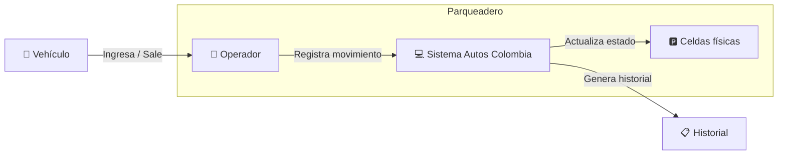
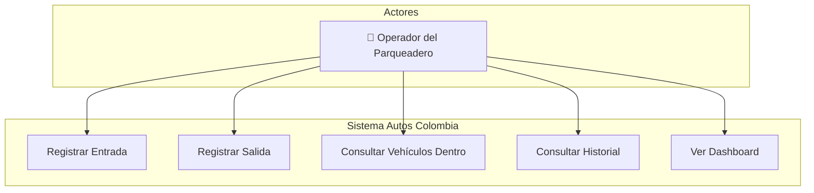
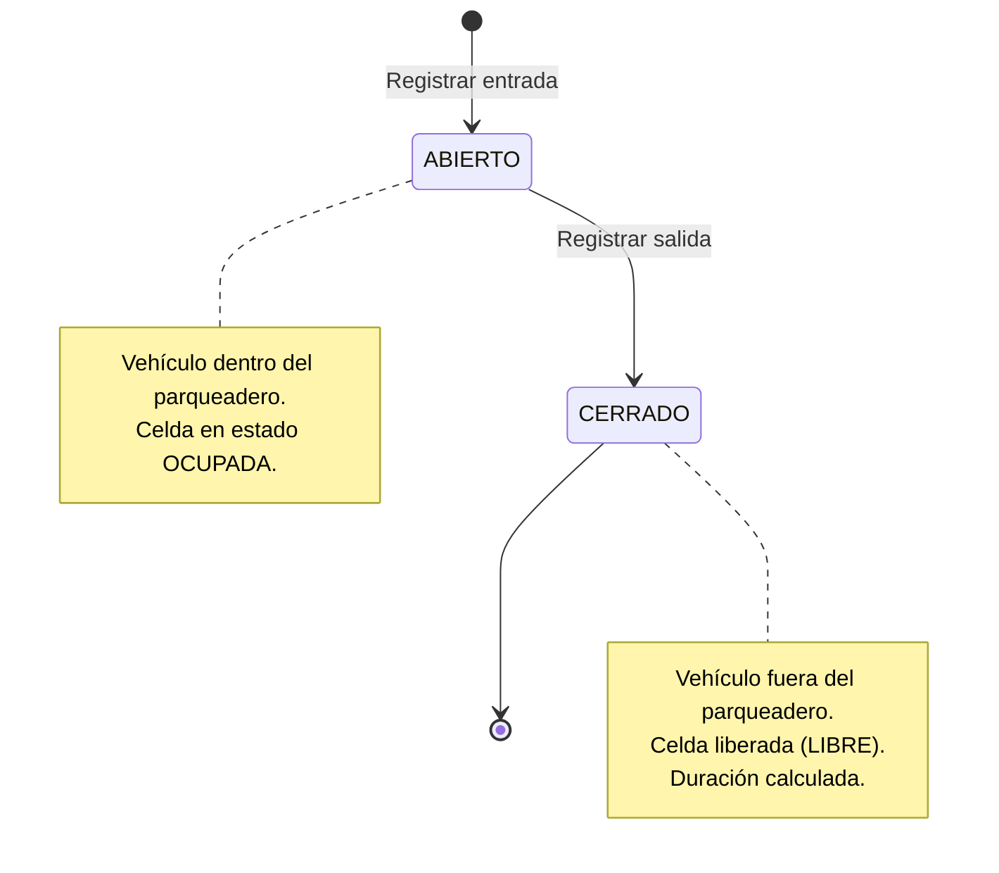
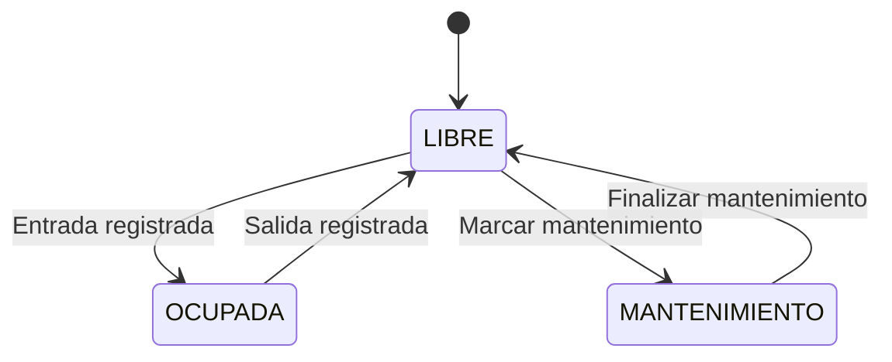

# 📄 Especificación Funcional — Autos Colombia

**Versión:** 1.0  
**Iteración:** 1  
**Fecha:** Octubre 2026  
**Estado:** Aprobado

---

## 1. Visión General

**Autos Colombia** es un sistema de gestión de parqueaderos por mensualidad que permite a los operadores registrar entradas y salidas de vehículos, controlar la ocupación de celdas, agregar observaciones sobre el estado de los vehículos y consultar el historial de movimientos.

El sistema está orientado a parqueaderos que manejan clientes con suscripción mensual, donde los vehículos registrados pueden ingresar y salir libremente dentro de su periodo de vigencia.

### 1.1 Objetivo del sistema

Digitalizar y optimizar el proceso de control de acceso vehicular en un parqueadero, reemplazando registros manuales con una aplicación web intuitiva que permita:

- Registrar entradas y salidas de forma ágil
- Controlar la ocupación en tiempo real
- Mantener un historial auditable de todos los movimientos
- Documentar observaciones sobre el estado de los vehículos

### 1.2 Contexto de negocio

---

## 2. Alcance de la Iteración 1

### 2.1 Incluido

| Módulo | Funcionalidad |
|--------|---------------|
| Dashboard | Indicadores de ocupación, accesos rápidos, tabla de vehículos dentro |
| Entradas | Búsqueda de vehículo por placa, selección de celda, observaciones, confirmación |
| Salidas | Lista de vehículos dentro, detalle de estancia, observaciones de salida, confirmación |
| Movimientos | Historial completo con filtros por placa, rango de fechas y estado |
| Datos demo | Generación automática de datos ficticios al primer inicio |

### 2.2 Excluido (futuras iteraciones)

| Módulo | Justificación |
|--------|---------------|
| Gestión de pagos y mensualidades | Requiere definición de modelo financiero |
| Autenticación de usuarios | Se implementará con JWT en iteración 2 |
| Administración de clientes/vehículos | CRUD completo en iteración 2 |
| Base de datos MySQL | Migración planificada; la arquitectura actual lo soporta |

---

## 3. Requisitos Funcionales

### RF-01: Registrar entrada de vehículo

| Campo | Detalle |
|-------|---------|
| **ID** | RF-01 |
| **Descripción** | El sistema debe permitir registrar la entrada de un vehículo al parqueadero, asociándolo a una celda disponible y registrando la fecha/hora de ingreso. |
| **Actor** | Operador |
| **Entrada** | Placa del vehículo, celda seleccionada, observaciones opcionales |
| **Salida** | Movimiento creado con estado ABIERTO, celda marcada como OCUPADA |
| **Reglas** | El vehículo debe existir y estar activo. No debe tener un movimiento abierto previo. La celda debe estar LIBRE y ser compatible con el tipo de vehículo. |

### RF-02: Registrar salida de vehículo

| Campo | Detalle |
|-------|---------|
| **ID** | RF-02 |
| **Descripción** | El sistema debe permitir registrar la salida de un vehículo, cerrando el movimiento abierto y liberando la celda asignada. |
| **Actor** | Operador |
| **Entrada** | ID del movimiento abierto, observaciones opcionales de salida |
| **Salida** | Movimiento actualizado con estado CERRADO, fecha/hora de salida y duración calculada. Celda marcada como LIBRE. |
| **Reglas** | Solo se puede registrar salida para movimientos con estado ABIERTO. |

### RF-03: Consultar vehículos dentro del parqueadero

| Campo | Detalle |
|-------|---------|
| **ID** | RF-03 |
| **Descripción** | El sistema debe mostrar la lista de todos los vehículos que se encuentran actualmente dentro del parqueadero (movimientos abiertos). |
| **Actor** | Operador |
| **Salida** | Lista de movimientos abiertos con datos del vehículo, celda asignada y hora de entrada. |

### RF-04: Consultar historial de movimientos

| Campo | Detalle |
|-------|---------|
| **ID** | RF-04 |
| **Descripción** | El sistema debe permitir consultar el historial completo de entradas y salidas con capacidad de filtrado. |
| **Actor** | Operador |
| **Filtros disponibles** | Placa del vehículo (búsqueda parcial), rango de fechas (desde/hasta), estado del movimiento (ABIERTO/CERRADO) |
| **Salida** | Lista paginada de movimientos ordenados por fecha descendente. |

### RF-05: Buscar vehículos por placa

| Campo | Detalle |
|-------|---------|
| **ID** | RF-05 |
| **Descripción** | El sistema debe permitir buscar vehículos registrados por su placa, soportando búsqueda parcial (contiene). |
| **Actor** | Operador |
| **Entrada** | Texto de búsqueda (mínimo 2 caracteres) |
| **Salida** | Lista de vehículos que coinciden, incluyendo datos del propietario. |

### RF-06: Consultar celdas por estado

| Campo | Detalle |
|-------|---------|
| **ID** | RF-06 |
| **Descripción** | El sistema debe permitir consultar las celdas del parqueadero filtradas por estado. |
| **Actor** | Operador |
| **Filtros** | Estado: LIBRE, OCUPADA, MANTENIMIENTO |
| **Salida** | Lista de celdas con su código, tipo, ubicación y estado actual. |

### RF-07: Mostrar dashboard de ocupación

| Campo | Detalle |
|-------|---------|
| **ID** | RF-07 |
| **Descripción** | El sistema debe presentar un resumen visual con indicadores de ocupación del parqueadero. |
| **Actor** | Operador |
| **Indicadores** | Total de celdas, celdas libres, celdas ocupadas, porcentaje de ocupación, vehículos dentro, movimientos del día. |

### RF-08: Registrar observaciones de vehículos

| Campo | Detalle |
|-------|---------|
| **ID** | RF-08 |
| **Descripción** | El sistema debe permitir registrar observaciones textuales tanto en la entrada como en la salida de un vehículo. |
| **Actor** | Operador |
| **Detalle** | Las observaciones de entrada y salida se almacenan de forma independiente dentro del mismo movimiento. Son opcionales. |
| **Uso típico** | "Rayón en puerta trasera derecha", "Espejo lateral roto", "Sin novedades" |

---

## 4. Requisitos No Funcionales

### RNF-01: Rendimiento

| Campo | Detalle |
|-------|---------|
| **ID** | RNF-01 |
| **Descripción** | Las respuestas de la API deben procesarse en menos de 500 ms para las operaciones estándar. |
| **Métrica** | Tiempo de respuesta p95 < 500 ms |

### RNF-02: Usabilidad

| Campo | Detalle |
|-------|---------|
| **ID** | RNF-02 |
| **Descripción** | La interfaz debe ser intuitiva y operable sin capacitación previa. Los flujos principales (entrada/salida) deben completarse en menos de 5 clics. |
| **Métrica** | Flujo de entrada: ≤ 4 pasos. Flujo de salida: ≤ 3 pasos. |

### RNF-03: Disponibilidad

| Campo | Detalle |
|-------|---------|
| **ID** | RNF-03 |
| **Descripción** | El sistema debe estar disponible durante el horario de operación del parqueadero (6:00 AM — 10:00 PM). |
| **Métrica** | Uptime ≥ 99% durante horario de operación. |

### RNF-04: Mantenibilidad

| Campo | Detalle |
|-------|---------|
| **ID** | RNF-04 |
| **Descripción** | El código debe seguir una arquitectura por capas que permita modificar la capa de persistencia sin afectar la lógica de negocio ni la interfaz de usuario. |
| **Criterio** | Sustituir repositorios JSON por MySQL sin modificar servicios, controladores ni componentes React. |

### RNF-05: Compatibilidad

| Campo | Detalle |
|-------|---------|
| **ID** | RNF-05 |
| **Descripción** | La aplicación debe funcionar correctamente en los navegadores modernos más comunes. |
| **Navegadores soportados** | Chrome 90+, Firefox 90+, Edge 90+, Safari 15+ |

### RNF-06: Portabilidad de datos

| Campo | Detalle |
|-------|---------|
| **ID** | RNF-06 |
| **Descripción** | Los datos almacenados en archivos JSON deben poder migrarse a una base de datos relacional sin pérdida de información. |
| **Criterio** | Modelo de datos diseñado con relaciones claras y esquema SQL definido como referencia futura. |

---

## 5. Actores del Sistema

### Operador del Parqueadero

| Aspecto | Detalle |
|---------|---------|
| **Rol** | Usuario principal del sistema |
| **Responsabilidades** | Registrar entradas y salidas, documentar observaciones, consultar ocupación e historial |
| **Perfil técnico** | Conocimiento básico de computación; no requiere formación técnica |
| **Frecuencia de uso** | Diaria, durante todo el horario de operación |

> **Nota:** En esta iteración no existe autenticación. Se utiliza un operador de demostración (Carlos Ramírez) de forma automática. La gestión de usuarios se implementará en la iteración 2.

---

## 6. Reglas de Negocio

| ID | Regla | Descripción |
|----|-------|-------------|
| RN-01 | **Vehículo activo** | Solo los vehículos con estado `activo: true` pueden ingresar al parqueadero. |
| RN-02 | **Sin movimiento abierto** | Un vehículo no puede tener más de un movimiento abierto simultáneamente. Si ya está dentro, no puede registrar otra entrada. |
| RN-03 | **Celda libre** | Solo se puede asignar una celda que esté en estado `LIBRE`. Las celdas en `MANTENIMIENTO` u `OCUPADA` no son seleccionables. |
| RN-04 | **Compatibilidad celda-vehículo** | El tipo de celda debe ser compatible con el tipo de vehículo (ej: una moto no puede asignarse a una celda de camioneta y viceversa). |
| RN-05 | **Celda se ocupa al entrar** | Al registrar una entrada, la celda seleccionada cambia automáticamente de `LIBRE` a `OCUPADA`. |
| RN-06 | **Celda se libera al salir** | Al registrar una salida, la celda asociada al movimiento cambia automáticamente de `OCUPADA` a `LIBRE`. |
| RN-07 | **Cálculo de duración** | Al registrar la salida, el sistema calcula automáticamente la duración de la estancia como la diferencia entre la hora de salida y la hora de entrada. |
| RN-08 | **Observaciones independientes** | Las observaciones de entrada y salida se almacenan como campos separados dentro del movimiento. Ambas son opcionales. |
| RN-09 | **Datos demo auto-generados** | Si no existen archivos de datos al iniciar el servidor, el sistema genera automáticamente un conjunto de datos de demostración realistas. |

### Diagrama de estados — Movimiento

### Diagrama de estados — Celda

---

## 7. Glosario

| Término | Definición |
|---------|-----------|
| **Parqueadero** | Estacionamiento o parking. Instalación física donde se guardan los vehículos. |
| **Celda** | Espacio individual dentro del parqueadero destinado a un vehículo. Tiene código, tipo y ubicación. |
| **Movimiento** | Registro de una entrada y (opcionalmente) su correspondiente salida. Un movimiento ABIERTO indica que el vehículo está dentro. |
| **Placa** | Matrícula o número de identificación del vehículo (formato colombiano). |
| **Operador** | Persona encargada de gestionar las entradas y salidas en el parqueadero. |
| **Mensualidad** | Modelo de negocio donde los clientes pagan una tarifa mensual por el servicio de parqueadero. |
| **Observaciones** | Notas textuales opcionales que el operador registra sobre el estado del vehículo al ingresar o salir. |
