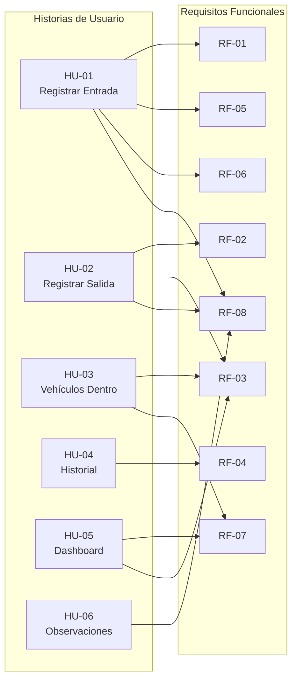

# 📖 Historias de Usuario — Autos Colombia

**Versión:** 1.0  
**Iteración:** 1  
**Fecha:** Octubre 2026

---

## Resumen de Historias

| ID | Título | Prioridad | Estado |
|----|--------|-----------|--------|
| HU-01 | Registrar entrada de vehículo | 🔴 Alta | Implementada |
| HU-02 | Registrar salida de vehículo | 🔴 Alta | Implementada |
| HU-03 | Consultar vehículos dentro del parqueadero | 🔴 Alta | Implementada |
| HU-04 | Consultar historial de movimientos | 🟡 Media | Implementada |
| HU-05 | Ver dashboard de ocupación | 🟡 Media | Implementada |
| HU-06 | Registrar observaciones de vehículos | 🟢 Baja | Implementada |

---

## HU-01: Registrar entrada de vehículo

**Como** operador del parqueadero,  
**quiero** registrar la entrada de un vehículo buscándolo por placa y asignándole una celda disponible,  
**para** llevar un control preciso de los vehículos que se encuentran dentro del parqueadero.

### Criterios de aceptación

- [ ] El operador puede buscar un vehículo ingresando al menos 2 caracteres de la placa.
- [ ] El sistema muestra los vehículos que coinciden con la búsqueda, incluyendo placa, tipo, marca, modelo, color y nombre del propietario.
- [ ] Solo se muestran vehículos con estado activo.
- [ ] Si el vehículo ya tiene un movimiento abierto, el sistema muestra un mensaje de error indicando que ya se encuentra dentro del parqueadero.
- [ ] El operador puede seleccionar una celda de la lista de celdas libres compatibles con el tipo de vehículo.
- [ ] El operador puede agregar observaciones opcionales sobre el estado del vehículo.
- [ ] Al confirmar, el sistema crea un movimiento con estado ABIERTO y marca la celda como OCUPADA.
- [ ] El sistema muestra un mensaje de confirmación con el resumen de la entrada registrada.

### Prioridad

🔴 **Alta** — Funcionalidad esencial para la operación del parqueadero.

### Requisitos relacionados

- RF-01: Registrar entrada de vehículo
- RF-05: Buscar vehículos por placa
- RF-06: Consultar celdas por estado
- RF-08: Registrar observaciones de vehículos
- RN-01, RN-02, RN-03, RN-04, RN-05

---

## HU-02: Registrar salida de vehículo

**Como** operador del parqueadero,  
**quiero** registrar la salida de un vehículo que se encuentra dentro del parqueadero,  
**para** liberar la celda asignada y cerrar el registro del movimiento con la duración de la estancia.

### Criterios de aceptación

- [ ] El sistema muestra la lista de vehículos que se encuentran actualmente dentro del parqueadero (movimientos abiertos).
- [ ] Cada elemento de la lista muestra: placa, tipo de vehículo, celda asignada, hora de entrada y tiempo transcurrido.
- [ ] El operador puede seleccionar un vehículo para registrar su salida.
- [ ] Al seleccionar, el sistema muestra el detalle completo del movimiento: datos del vehículo, celda, hora de entrada, observaciones de entrada y duración actual.
- [ ] El operador puede agregar observaciones opcionales de salida.
- [ ] Al confirmar la salida, el sistema cierra el movimiento (estado CERRADO), registra la hora de salida, calcula la duración y libera la celda (estado LIBRE).
- [ ] El sistema muestra un mensaje de confirmación con el resumen de la salida registrada.

### Prioridad

🔴 **Alta** — Funcionalidad esencial para la operación del parqueadero.

### Requisitos relacionados

- RF-02: Registrar salida de vehículo
- RF-03: Consultar vehículos dentro del parqueadero
- RF-08: Registrar observaciones de vehículos
- RN-06, RN-07, RN-08

---

## HU-03: Consultar vehículos dentro del parqueadero

**Como** operador del parqueadero,  
**quiero** ver una lista actualizada de todos los vehículos que se encuentran actualmente dentro del parqueadero,  
**para** conocer la ocupación actual y poder ubicar rápidamente cualquier vehículo.

### Criterios de aceptación

- [ ] El sistema muestra una tabla con todos los movimientos abiertos (vehículos dentro).
- [ ] Cada fila muestra: placa, tipo de vehículo, marca y modelo, celda asignada, hora de entrada y tiempo transcurrido.
- [ ] La tabla se ordena por hora de entrada (más reciente primero).
- [ ] Si no hay vehículos dentro, el sistema muestra un mensaje indicándolo.
- [ ] La información se puede refrescar manualmente o se actualiza al navegar a la vista.

### Prioridad

🔴 **Alta** — Necesaria para la visibilidad en tiempo real de la ocupación.

### Requisitos relacionados

- RF-03: Consultar vehículos dentro del parqueadero
- RF-07: Mostrar dashboard de ocupación

---

## HU-04: Consultar historial de movimientos

**Como** operador del parqueadero,  
**quiero** consultar el historial de todos los movimientos (entradas y salidas) con filtros de búsqueda,  
**para** auditar la actividad del parqueadero y buscar movimientos específicos.

### Criterios de aceptación

- [ ] El sistema muestra una tabla con todos los movimientos, ordenados por fecha de entrada descendente.
- [ ] Cada fila muestra: placa, tipo de vehículo, celda, fecha/hora de entrada, fecha/hora de salida (si aplica), duración, estado (ABIERTO/CERRADO) y un indicador visual del estado.
- [ ] El operador puede filtrar por placa (búsqueda parcial, no sensible a mayúsculas/minúsculas).
- [ ] El operador puede filtrar por rango de fechas (fecha desde y fecha hasta).
- [ ] El operador puede filtrar por estado del movimiento (ABIERTO, CERRADO o todos).
- [ ] Los filtros se pueden combinar entre sí.
- [ ] El operador puede limpiar todos los filtros con un solo clic.
- [ ] Si no hay resultados, el sistema muestra un mensaje indicándolo.

### Prioridad

🟡 **Media** — Importante para auditoría pero no bloquea la operación diaria.

### Requisitos relacionados

- RF-04: Consultar historial de movimientos

---

## HU-05: Ver dashboard de ocupación

**Como** operador del parqueadero,  
**quiero** ver un resumen visual con los indicadores principales de ocupación del parqueadero,  
**para** tener una visión rápida del estado actual sin necesidad de navegar a otras pantallas.

### Criterios de aceptación

- [ ] El dashboard muestra las siguientes tarjetas con indicadores:
  - Total de celdas del parqueadero
  - Celdas libres (con cantidad y color verde)
  - Celdas ocupadas (con cantidad y color indicativo)
  - Porcentaje de ocupación
  - Vehículos actualmente dentro
  - Movimientos del día (entradas registradas hoy)
- [ ] El dashboard incluye accesos rápidos (botones) a las funciones principales: Registrar Entrada y Registrar Salida.
- [ ] El dashboard incluye una tabla resumen de los vehículos que se encuentran dentro del parqueadero.
- [ ] Los indicadores se actualizan al cargar la página.

### Prioridad

🟡 **Media** — Mejora significativa en la experiencia del usuario, pero el sistema funciona sin ella.

### Requisitos relacionados

- RF-07: Mostrar dashboard de ocupación
- RF-03: Consultar vehículos dentro del parqueadero

---

## HU-06: Registrar observaciones de vehículos

**Como** operador del parqueadero,  
**quiero** poder registrar observaciones sobre el estado del vehículo tanto al momento de la entrada como al momento de la salida,  
**para** documentar cualquier novedad (rayones, golpes, objetos dejados) y tener un registro que evite disputas con los clientes.

### Criterios de aceptación

- [ ] En el formulario de entrada, existe un campo de texto para observaciones de entrada (opcional).
- [ ] En el formulario de salida, existe un campo de texto para observaciones de salida (opcional).
- [ ] Las observaciones de entrada y salida se almacenan como campos independientes dentro del mismo movimiento.
- [ ] Las observaciones se muestran en el detalle del movimiento y en la confirmación de entrada/salida.
- [ ] El campo de observaciones permite texto libre con un máximo de 500 caracteres.
- [ ] Si no se ingresan observaciones, el campo se almacena como `null` sin generar error.

### Prioridad

🟢 **Baja** — Valor agregado para documentación, pero la operación básica funciona sin observaciones.

### Requisitos relacionados

- RF-08: Registrar observaciones de vehículos
- RN-08: Observaciones independientes

---

## Mapa de Historias vs. Requisitos

