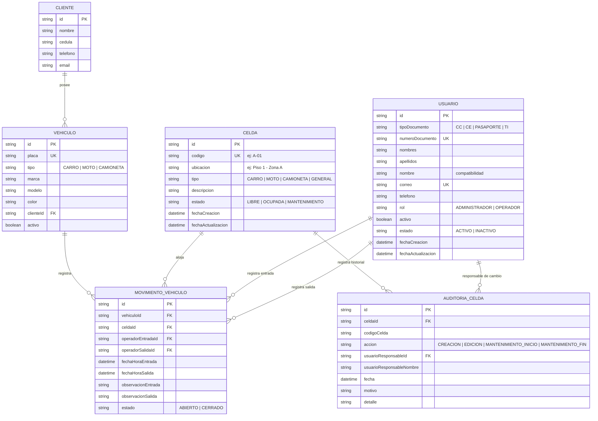

# 📊 Modelo de Datos y Clases — Autos Colombia

**Versión:** 2.0 (Iteración 1 e Iteración 2)  
**Fecha:** Noviembre 2026

---

## 1. Modelo Entidad-Relación Conceptual (Mermaid)



---

## 2. Definición DDL para Base de Datos Relacional Futura (MySQL)

> **Nota:** Este script DDL se documenta como referencia técnica para la futura migración a MySQL. Actualmente, toda la persistencia se gestiona en archivos JSON atómicos dentro de `backend/data/`.

```sql
-- Creación de la base de datos
CREATE DATABASE IF NOT EXISTS autos_colombia
  CHARACTER SET utf8mb4
  COLLATE utf8mb4_unicode_ci;

USE autos_colombia;

-- Tabla de Clientes
CREATE TABLE IF NOT EXISTS clientes (
  id VARCHAR(36) PRIMARY KEY,
  nombre VARCHAR(120) NOT NULL,
  cedula VARCHAR(20) NOT NULL UNIQUE,
  telefono VARCHAR(20) NOT NULL,
  email VARCHAR(120) NOT NULL,
  created_at TIMESTAMP DEFAULT CURRENT_TIMESTAMP
) ENGINE=InnoDB;

-- Tabla de Vehículos
CREATE TABLE IF NOT EXISTS vehiculos (
  id VARCHAR(36) PRIMARY KEY,
  placa VARCHAR(10) NOT NULL UNIQUE,
  tipo ENUM('CARRO', 'MOTO', 'CAMIONETA') NOT NULL,
  marca VARCHAR(50) NOT NULL,
  modelo VARCHAR(50) NOT NULL,
  color VARCHAR(30) NOT NULL,
  cliente_id VARCHAR(36) NOT NULL,
  activo BOOLEAN NOT NULL DEFAULT TRUE,
  created_at TIMESTAMP DEFAULT CURRENT_TIMESTAMP,
  CONSTRAINT fk_vehiculo_cliente FOREIGN KEY (cliente_id) REFERENCES clientes(id)
) ENGINE=InnoDB;

-- Tabla de Usuarios
CREATE TABLE IF NOT EXISTS usuarios (
  id VARCHAR(36) PRIMARY KEY,
  tipo_documento ENUM('CC', 'CE', 'PASAPORTE', 'TI') NOT NULL DEFAULT 'CC',
  numero_documento VARCHAR(20) NOT NULL UNIQUE,
  nombres VARCHAR(80) NOT NULL,
  apellidos VARCHAR(80) NOT NULL,
  correo VARCHAR(120) NOT NULL UNIQUE,
  telefono VARCHAR(20),
  rol ENUM('ADMINISTRADOR', 'OPERADOR') NOT NULL DEFAULT 'OPERADOR',
  estado ENUM('ACTIVO', 'INACTIVO') NOT NULL DEFAULT 'ACTIVO',
  created_at TIMESTAMP DEFAULT CURRENT_TIMESTAMP,
  updated_at TIMESTAMP DEFAULT CURRENT_TIMESTAMP ON UPDATE CURRENT_TIMESTAMP
) ENGINE=InnoDB;

-- Tabla de Celdas
CREATE TABLE IF NOT EXISTS celdas (
  id VARCHAR(36) PRIMARY KEY,
  codigo VARCHAR(10) NOT NULL UNIQUE,
  ubicacion VARCHAR(100) NOT NULL,
  tipo ENUM('CARRO', 'MOTO', 'CAMIONETA', 'GENERAL') NOT NULL DEFAULT 'CARRO',
  descripcion VARCHAR(255),
  estado ENUM('LIBRE', 'OCUPADA', 'MANTENIMIENTO') NOT NULL DEFAULT 'LIBRE',
  created_at TIMESTAMP DEFAULT CURRENT_TIMESTAMP,
  updated_at TIMESTAMP DEFAULT CURRENT_TIMESTAMP ON UPDATE CURRENT_TIMESTAMP
) ENGINE=InnoDB;

-- Tabla de Movimientos de Vehículos
CREATE TABLE IF NOT EXISTS movimientos_vehiculo (
  id VARCHAR(36) PRIMARY KEY,
  vehiculo_id VARCHAR(36) NOT NULL,
  celda_id VARCHAR(36) NOT NULL,
  operador_entrada_id VARCHAR(36) NOT NULL,
  operador_salida_id VARCHAR(36),
  fecha_hora_entrada TIMESTAMP NOT NULL,
  fecha_hora_salida TIMESTAMP NULL,
  observacion_entrada TEXT,
  observacion_salida TEXT,
  estado ENUM('ABIERTO', 'CERRADO') NOT NULL DEFAULT 'ABIERTO',
  CONSTRAINT fk_mov_vehiculo FOREIGN KEY (vehiculo_id) REFERENCES vehiculos(id),
  CONSTRAINT fk_mov_celda FOREIGN KEY (celda_id) REFERENCES celdas(id),
  CONSTRAINT fk_mov_op_entrada FOREIGN KEY (operador_entrada_id) REFERENCES usuarios(id),
  CONSTRAINT fk_mov_op_salida FOREIGN KEY (operador_salida_id) REFERENCES usuarios(id)
) ENGINE=InnoDB;

-- Tabla de Auditoría Histórica de Celdas (Iteración 2 - RF27)
CREATE TABLE IF NOT EXISTS auditorias_celda (
  id VARCHAR(36) PRIMARY KEY,
  celda_id VARCHAR(36) NOT NULL,
  codigo_celda VARCHAR(10) NOT NULL,
  accion ENUM('CREACION', 'EDICION', 'MANTENIMIENTO_INICIO', 'MANTENIMIENTO_FIN') NOT NULL,
  usuario_responsable_id VARCHAR(36) NOT NULL,
  usuario_responsable_nombre VARCHAR(120) NOT NULL,
  fecha TIMESTAMP DEFAULT CURRENT_TIMESTAMP,
  motivo VARCHAR(255) NOT NULL,
  detalle TEXT,
  CONSTRAINT fk_auditoria_celda FOREIGN KEY (celda_id) REFERENCES celdas(id) ON DELETE CASCADE,
  CONSTRAINT fk_auditoria_usuario FOREIGN KEY (usuario_responsable_id) REFERENCES usuarios(id)
) ENGINE=InnoDB;
```
