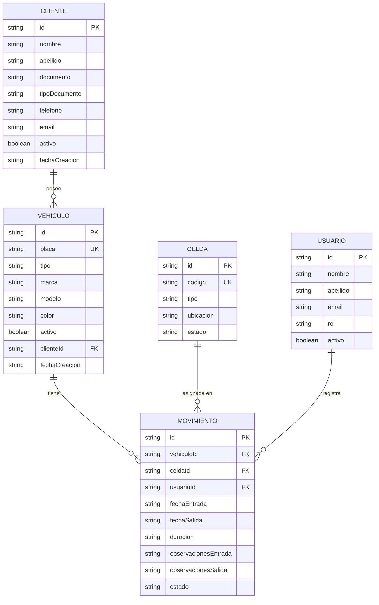

# 📊 Modelo de Datos — Autos Colombia

**Versión:** 1.0  
**Iteración:** 1  
**Fecha:** Octubre 2026

---

## 1. Modelo Entidad-Relación Conceptual



---

## 2. Descripción de Entidades

### 2.1 Cliente

Representa al propietario de uno o más vehículos registrados en el parqueadero.

| Atributo | Tipo | Obligatorio | Descripción |
|----------|------|:-----------:|-------------|
| `id` | `string (UUID)` | ✅ | Identificador único. Generado automáticamente. |
| `nombre` | `string` | ✅ | Nombre del cliente. |
| `apellido` | `string` | ✅ | Apellido del cliente. |
| `documento` | `string` | ✅ | Número de documento de identidad. |
| `tipoDocumento` | `string` | ✅ | Tipo de documento: `CC` (Cédula de Ciudadanía), `CE` (Cédula de Extranjería), `NIT`. |
| `telefono` | `string` | ✅ | Número de teléfono de contacto. |
| `email` | `string` | ❌ | Correo electrónico. |
| `activo` | `boolean` | ✅ | Estado del cliente. `true` = activo, `false` = inactivo. |
| `fechaCreacion` | `string (ISO 8601)` | ✅ | Fecha y hora de creación del registro. |

### 2.2 Vehículo

Representa un vehículo registrado en el sistema, asociado a un cliente.

| Atributo | Tipo | Obligatorio | Descripción |
|----------|------|:-----------:|-------------|
| `id` | `string (UUID)` | ✅ | Identificador único. |
| `placa` | `string` | ✅ | Placa del vehículo (formato colombiano). Única en el sistema. |
| `tipo` | `string` | ✅ | Tipo de vehículo: `CARRO`, `MOTO`, `CAMIONETA`. |
| `marca` | `string` | ✅ | Marca del vehículo (ej: Chevrolet, Renault, Mazda). |
| `modelo` | `string` | ✅ | Modelo del vehículo (ej: Spark, Logan, CX-5). |
| `color` | `string` | ✅ | Color del vehículo. |
| `activo` | `boolean` | ✅ | Estado del vehículo. Solo los activos pueden ingresar. |
| `clienteId` | `string (UUID)` | ✅ | Referencia al cliente propietario. |
| `fechaCreacion` | `string (ISO 8601)` | ✅ | Fecha y hora de creación del registro. |

**Valores permitidos para `tipo`:**

| Valor | Descripción |
|-------|-------------|
| `CARRO` | Automóvil sedan, hatchback, etc. |
| `MOTO` | Motocicleta |
| `CAMIONETA` | Camioneta, SUV, van |

### 2.3 Celda

Representa un espacio de estacionamiento dentro del parqueadero.

| Atributo | Tipo | Obligatorio | Descripción |
|----------|------|:-----------:|-------------|
| `id` | `string (UUID)` | ✅ | Identificador único. |
| `codigo` | `string` | ✅ | Código de la celda (ej: `A-01`, `B-05`, `M-03`). Único. |
| `tipo` | `string` | ✅ | Tipo de celda: `CARRO`, `MOTO`, `CAMIONETA`. |
| `ubicacion` | `string` | ✅ | Ubicación descriptiva (ej: "Piso 1 - Zona A", "Sótano - Zona Motos"). |
| `estado` | `string` | ✅ | Estado actual: `LIBRE`, `OCUPADA`, `MANTENIMIENTO`. |

**Valores permitidos para `estado`:**

| Valor | Descripción |
|-------|-------------|
| `LIBRE` | Disponible para asignación |
| `OCUPADA` | Actualmente ocupada por un vehículo |
| `MANTENIMIENTO` | Fuera de servicio temporalmente |

**Regla de compatibilidad celda-vehículo:**

| Tipo de celda | Tipos de vehículo permitidos |
|---------------|------------------------------|
| `CARRO` | `CARRO` |
| `MOTO` | `MOTO` |
| `CAMIONETA` | `CAMIONETA` |

### 2.4 Movimiento

Representa el registro de entrada y (opcionalmente) salida de un vehículo.

| Atributo | Tipo | Obligatorio | Descripción |
|----------|------|:-----------:|-------------|
| `id` | `string (UUID)` | ✅ | Identificador único. |
| `vehiculoId` | `string (UUID)` | ✅ | Referencia al vehículo. |
| `celdaId` | `string (UUID)` | ✅ | Referencia a la celda asignada. |
| `usuarioId` | `string (UUID)` | ✅ | Referencia al operador que registró el movimiento. |
| `fechaEntrada` | `string (ISO 8601)` | ✅ | Fecha y hora de ingreso. |
| `fechaSalida` | `string (ISO 8601)` | ❌ | Fecha y hora de salida. `null` mientras el movimiento está abierto. |
| `duracion` | `string` | ❌ | Duración de la estancia (calculada). Formato legible (ej: "2h 35min"). `null` mientras abierto. |
| `observacionesEntrada` | `string` | ❌ | Observaciones registradas al ingreso. Máximo 500 caracteres. |
| `observacionesSalida` | `string` | ❌ | Observaciones registradas a la salida. Máximo 500 caracteres. |
| `estado` | `string` | ✅ | Estado del movimiento: `ABIERTO` o `CERRADO`. |

**Valores permitidos para `estado`:**

| Valor | Descripción |
|-------|-------------|
| `ABIERTO` | El vehículo está dentro del parqueadero. |
| `CERRADO` | El vehículo salió. El movimiento tiene hora de salida y duración calculada. |

### 2.5 Usuario

Representa a un operador o administrador del sistema.

| Atributo | Tipo | Obligatorio | Descripción |
|----------|------|:-----------:|-------------|
| `id` | `string (UUID)` | ✅ | Identificador único. |
| `nombre` | `string` | ✅ | Nombre del usuario. |
| `apellido` | `string` | ✅ | Apellido del usuario. |
| `email` | `string` | ✅ | Correo electrónico. |
| `rol` | `string` | ✅ | Rol: `OPERADOR`, `ADMINISTRADOR`. |
| `activo` | `boolean` | ✅ | Estado del usuario. |

> **Nota:** En la iteración 1, no hay autenticación. Se utiliza un usuario operador de demostración de forma automática. La gestión de usuarios se implementará en una iteración posterior.

---

## 3. Relaciones y Cardinalidades

| Relación | Cardinalidad | Descripción |
|----------|:------------:|-------------|
| Cliente → Vehículo | 1:N | Un cliente puede poseer uno o más vehículos. Un vehículo pertenece a exactamente un cliente. |
| Vehículo → Movimiento | 1:N | Un vehículo puede tener muchos movimientos a lo largo del tiempo. Un movimiento pertenece a exactamente un vehículo. |
| Celda → Movimiento | 1:N | Una celda puede estar en muchos movimientos (en diferentes momentos). Un movimiento se asocia a exactamente una celda. |
| Usuario → Movimiento | 1:N | Un usuario puede registrar muchos movimientos. Un movimiento es registrado por exactamente un usuario. |

### Restricciones de integridad

- Un vehículo solo puede tener **un movimiento ABIERTO a la vez**.
- Una celda en estado `OCUPADA` solo puede estar asociada a **un movimiento ABIERTO**.
- Al registrar una entrada, la celda cambia de `LIBRE` a `OCUPADA`.
- Al registrar una salida, la celda cambia de `OCUPADA` a `LIBRE`.

---

## 4. Restricciones de Negocio

| ID | Restricción | Entidad | Regla |
|----|-------------|---------|-------|
| RN-01 | Vehículo activo | Vehículo | Solo vehículos con `activo = true` pueden registrar entradas. |
| RN-02 | Movimiento único abierto | Movimiento | `COUNT(estado = 'ABIERTO' AND vehiculoId = X)` debe ser 0 o 1. |
| RN-03 | Celda disponible | Celda | Solo celdas con `estado = 'LIBRE'` se pueden asignar. |
| RN-04 | Compatibilidad tipo | Celda + Vehículo | `celda.tipo` debe ser igual a `vehiculo.tipo`. |
| RN-05 | Placa única | Vehículo | La placa no puede repetirse entre vehículos. |
| RN-06 | Documento único | Cliente | El documento no puede repetirse entre clientes. |
| RN-07 | Código celda único | Celda | El código de celda no puede repetirse. |
| RN-08 | Observaciones opcionales | Movimiento | `observacionesEntrada` y `observacionesSalida` pueden ser `null`. Máximo 500 caracteres si se proporcionan. |

---

## 5. Modelo Relacional (Referencia Futura — MySQL)

> ⚠️ **IMPORTANTE:** El siguiente esquema SQL es una **referencia para la futura migración a MySQL**. En la iteración actual, los datos se almacenan en archivos JSON. Este DDL se proporciona como documentación para planificar la migración.

```sql
-- ============================================================
-- Autos Colombia — DDL para MySQL
-- Versión: 1.0 (referencia futura)
-- ============================================================

CREATE DATABASE IF NOT EXISTS autos_colombia
    CHARACTER SET utf8mb4
    COLLATE utf8mb4_unicode_ci;

USE autos_colombia;

-- ------------------------------------------------------------
-- Tabla: clientes
-- ------------------------------------------------------------
CREATE TABLE clientes (
    id              CHAR(36)        NOT NULL    PRIMARY KEY     COMMENT 'UUID',
    nombre          VARCHAR(100)    NOT NULL,
    apellido        VARCHAR(100)    NOT NULL,
    documento       VARCHAR(20)     NOT NULL,
    tipo_documento  ENUM('CC', 'CE', 'NIT') NOT NULL           COMMENT 'Tipo de documento',
    telefono        VARCHAR(20)     NOT NULL,
    email           VARCHAR(150)    NULL,
    activo          BOOLEAN         NOT NULL    DEFAULT TRUE,
    fecha_creacion  DATETIME        NOT NULL    DEFAULT CURRENT_TIMESTAMP,
    
    UNIQUE KEY uk_cliente_documento (documento)
) ENGINE=InnoDB COMMENT='Clientes (propietarios de vehículos)';

-- ------------------------------------------------------------
-- Tabla: vehiculos
-- ------------------------------------------------------------
CREATE TABLE vehiculos (
    id              CHAR(36)        NOT NULL    PRIMARY KEY     COMMENT 'UUID',
    placa           VARCHAR(10)     NOT NULL,
    tipo            ENUM('CARRO', 'MOTO', 'CAMIONETA') NOT NULL,
    marca           VARCHAR(50)     NOT NULL,
    modelo          VARCHAR(50)     NOT NULL,
    color           VARCHAR(30)     NOT NULL,
    activo          BOOLEAN         NOT NULL    DEFAULT TRUE,
    cliente_id      CHAR(36)        NOT NULL,
    fecha_creacion  DATETIME        NOT NULL    DEFAULT CURRENT_TIMESTAMP,
    
    UNIQUE KEY uk_vehiculo_placa (placa),
    CONSTRAINT fk_vehiculo_cliente
        FOREIGN KEY (cliente_id) REFERENCES clientes(id)
        ON UPDATE CASCADE ON DELETE RESTRICT
) ENGINE=InnoDB COMMENT='Vehículos registrados en el parqueadero';

-- ------------------------------------------------------------
-- Tabla: celdas
-- ------------------------------------------------------------
CREATE TABLE celdas (
    id              CHAR(36)        NOT NULL    PRIMARY KEY     COMMENT 'UUID',
    codigo          VARCHAR(10)     NOT NULL,
    tipo            ENUM('CARRO', 'MOTO', 'CAMIONETA') NOT NULL,
    ubicacion       VARCHAR(100)    NOT NULL,
    estado          ENUM('LIBRE', 'OCUPADA', 'MANTENIMIENTO') NOT NULL DEFAULT 'LIBRE',
    
    UNIQUE KEY uk_celda_codigo (codigo)
) ENGINE=InnoDB COMMENT='Celdas (espacios) del parqueadero';

-- ------------------------------------------------------------
-- Tabla: usuarios
-- ------------------------------------------------------------
CREATE TABLE usuarios (
    id              CHAR(36)        NOT NULL    PRIMARY KEY     COMMENT 'UUID',
    nombre          VARCHAR(100)    NOT NULL,
    apellido        VARCHAR(100)    NOT NULL,
    email           VARCHAR(150)    NOT NULL,
    rol             ENUM('OPERADOR', 'ADMINISTRADOR') NOT NULL DEFAULT 'OPERADOR',
    activo          BOOLEAN         NOT NULL    DEFAULT TRUE,
    
    UNIQUE KEY uk_usuario_email (email)
) ENGINE=InnoDB COMMENT='Usuarios del sistema (operadores, administradores)';

-- ------------------------------------------------------------
-- Tabla: movimientos
-- ------------------------------------------------------------
CREATE TABLE movimientos (
    id                      CHAR(36)        NOT NULL    PRIMARY KEY     COMMENT 'UUID',
    vehiculo_id             CHAR(36)        NOT NULL,
    celda_id                CHAR(36)        NOT NULL,
    usuario_id              CHAR(36)        NOT NULL,
    fecha_entrada           DATETIME        NOT NULL    DEFAULT CURRENT_TIMESTAMP,
    fecha_salida            DATETIME        NULL,
    duracion                VARCHAR(50)     NULL        COMMENT 'Duración legible (ej: 2h 35min)',
    observaciones_entrada   TEXT            NULL,
    observaciones_salida    TEXT            NULL,
    estado                  ENUM('ABIERTO', 'CERRADO') NOT NULL DEFAULT 'ABIERTO',
    
    CONSTRAINT fk_movimiento_vehiculo
        FOREIGN KEY (vehiculo_id) REFERENCES vehiculos(id)
        ON UPDATE CASCADE ON DELETE RESTRICT,
    CONSTRAINT fk_movimiento_celda
        FOREIGN KEY (celda_id) REFERENCES celdas(id)
        ON UPDATE CASCADE ON DELETE RESTRICT,
    CONSTRAINT fk_movimiento_usuario
        FOREIGN KEY (usuario_id) REFERENCES usuarios(id)
        ON UPDATE CASCADE ON DELETE RESTRICT,
    
    INDEX idx_movimiento_estado (estado),
    INDEX idx_movimiento_fecha_entrada (fecha_entrada),
    INDEX idx_movimiento_vehiculo (vehiculo_id)
) ENGINE=InnoDB COMMENT='Movimientos de entrada y salida de vehículos';

-- ------------------------------------------------------------
-- Restricción: un vehículo solo puede tener un movimiento abierto
-- (se verifica en la capa de aplicación; MySQL no soporta
--  partial unique indexes nativamente)
-- ------------------------------------------------------------
-- Alternativa con trigger:
DELIMITER //
CREATE TRIGGER trg_movimiento_unico_abierto
BEFORE INSERT ON movimientos
FOR EACH ROW
BEGIN
    DECLARE v_count INT;
    IF NEW.estado = 'ABIERTO' THEN
        SELECT COUNT(*) INTO v_count
        FROM movimientos
        WHERE vehiculo_id = NEW.vehiculo_id AND estado = 'ABIERTO';
        IF v_count > 0 THEN
            SIGNAL SQLSTATE '45000'
            SET MESSAGE_TEXT = 'El vehículo ya tiene un movimiento abierto';
        END IF;
    END IF;
END //
DELIMITER ;
```

---

## 6. Estructura JSON (Implementación Actual)

Los datos se almacenan en archivos JSON dentro de la carpeta `backend/data/`. Cada archivo contiene un arreglo de objetos.

### 6.1 `clientes.json`

```json
[
  {
    "id": "c1a2b3c4-d5e6-7890-abcd-ef1234567890",
    "nombre": "María",
    "apellido": "González Rodríguez",
    "documento": "1012345678",
    "tipoDocumento": "CC",
    "telefono": "3101234567",
    "email": "maria.gonzalez@email.com",
    "activo": true,
    "fechaCreacion": "2026-01-15T08:00:00.000Z"
  }
]
```

### 6.2 `vehiculos.json`

```json
[
  {
    "id": "v1a2b3c4-d5e6-7890-abcd-ef1234567890",
    "placa": "ABC123",
    "tipo": "CARRO",
    "marca": "Chevrolet",
    "modelo": "Spark",
    "color": "Blanco",
    "activo": true,
    "clienteId": "c1a2b3c4-d5e6-7890-abcd-ef1234567890",
    "fechaCreacion": "2026-01-15T08:30:00.000Z"
  }
]
```

### 6.3 `celdas.json`

```json
[
  {
    "id": "ce1a2b3c-d5e6-7890-abcd-ef1234567890",
    "codigo": "A-01",
    "tipo": "CARRO",
    "ubicacion": "Piso 1 - Zona A",
    "estado": "LIBRE"
  }
]
```

### 6.4 `usuarios.json`

```json
[
  {
    "id": "u1a2b3c4-d5e6-7890-abcd-ef1234567890",
    "nombre": "Carlos",
    "apellido": "Ramírez",
    "email": "carlos.ramirez@autoscolombia.com",
    "rol": "OPERADOR",
    "activo": true
  }
]
```

### 6.5 `movimientos.json`

```json
[
  {
    "id": "m1a2b3c4-d5e6-7890-abcd-ef1234567890",
    "vehiculoId": "v1a2b3c4-d5e6-7890-abcd-ef1234567890",
    "celdaId": "ce1a2b3c-d5e6-7890-abcd-ef1234567890",
    "usuarioId": "u1a2b3c4-d5e6-7890-abcd-ef1234567890",
    "fechaEntrada": "2026-10-25T08:15:00.000Z",
    "fechaSalida": null,
    "duracion": null,
    "observacionesEntrada": "Vehículo en buen estado. Sin novedades.",
    "observacionesSalida": null,
    "estado": "ABIERTO"
  },
  {
    "id": "m2b3c4d5-e6f7-8901-bcde-f12345678901",
    "vehiculoId": "v2b3c4d5-e6f7-8901-bcde-f12345678901",
    "celdaId": "ce2b3c4d-e6f7-8901-bcde-f12345678901",
    "usuarioId": "u1a2b3c4-d5e6-7890-abcd-ef1234567890",
    "fechaEntrada": "2026-10-24T14:30:00.000Z",
    "fechaSalida": "2026-10-24T18:45:00.000Z",
    "duracion": "4h 15min",
    "observacionesEntrada": "Rayón pequeño en puerta trasera derecha.",
    "observacionesSalida": "Sin novedades adicionales.",
    "estado": "CERRADO"
  }
]
```

---

## 7. Diagrama de Estructura JSON en Disco

```
backend/
└── data/                          # Auto-generado al primer inicio
    ├── clientes.json              # Array de objetos Cliente
    ├── vehiculos.json             # Array de objetos Vehículo
    ├── celdas.json                # Array de objetos Celda
    ├── usuarios.json              # Array de objetos Usuario
    └── movimientos.json           # Array de objetos Movimiento
```

> **Nota:** Si la carpeta `data/` no existe o los archivos faltan, el sistema los genera automáticamente con datos de demostración al iniciar el servidor.
